# Awesome E-Commerce Integration Middleware 🛍️⚡

  

  
  
  
  
  
  
  

---

## 🌟 Overview & Purpose

> **A curated showcase of top SaaS enterprise iPaaS platforms and open-source middleware projects for seamless e-commerce integration, multi-channel order routing, real-time inventory synchronization, and custom commerce bridges.** 🚀

Whether you are scaling a fast-growing DTC storefront, managing an enterprise ERP migration (NetSuite, SAP, MS Dynamics), connecting a 3PL warehouse fulfillment network, or orchestrating B2B PunchOut procurement flows, this guide provides an unbiased, developer-first roadmap.

**Last updated:** November 2026 📅

---

## 📑 Table of Contents

- [📈 Sector Overview & Market Dynamics](#-sector-overview--market-dynamics)
- [🏢 SaaS & Managed iPaaS Platforms](#-saas--managed-ipaas-platforms)
- [🔓 Open-Source Middleware & Connector Projects](#-open-source-middleware--connector-projects)
- [🤝 How to Contribute](#-how-to-contribute)
- [⚠️ Key Architectural Distinctions & Disclaimer](#️-key-architectural-distinctions--disclaimer)
- [📊 Star History](#-star-history)
- [💖 Support & Sponsorship](#-support--sponsorship)

---

## 📈 Sector Overview & Market Dynamics

The global **Integration Platform as a Service (iPaaS)** and dedicated e-commerce middleware market is estimated at approximately **$15B to $19B in 2025–2026**, expanding rapidly at a **~20–24% CAGR** driven by headless commerce architectures, omnichannel marketplace synchronization, and automated fulfillment operations. 

The sector is **moderately fragmented** rather than winner-take-all:
- **Horizontal & Enterprise Giants** (such as HubSpot, Boomi, and Workato) dominate enterprise automation, cross-departmental orchestrations, and massive application suites.
- **Vertical & Niche Specialists** (such as Celigo for NetSuite depth, Patchworks for DTC retail operations, and CartRover/Extensiv for WMS/3PL order routing) capture intense merchant loyalty by solving edge cases, custom data transformations, and supply chain protocols out of the box.
- **Open-Source Bridges & Engines** (such as n8n, Activepieces, Airbyte, Apache Camel, and stack-specific connectors) empower technical teams to eliminate vendor lock-in, safeguard customer PII, and maintain full control over internal commerce pipelines.

---

## 🏢 SaaS & Managed iPaaS Platforms

The table below outlines key commercial SaaS platforms, ranked in **descending order by company size** (market capitalization / valuation / annual recurring revenue).

| 🏢 Platform | 💰 Company Size (Valuation / Revenue) | 🏷️ Specific Starting Pricing | 🎁 Free Tier / Free Trial Limits | 🎯 Best For & Trade-offs |
| :--- | :--- | :--- | :--- | :--- |
| [**HubSpot E-commerce Integration**](https://www.hubspot.com/) | **~$12.5B Market Cap** (~$3.1B+ ARR) | Free tier available; paid Starter starts at **$15/seat/month**, Professional Commerce features start at **$85–$95/user/month** (billed annually) + payment processing fees | **Free forever plan**: Up to 2 users, basic payment links, quotes, and standard CRM/e-commerce sync | **Best for**: HubSpot CRM merchants needing direct storefront order sync to customer records. **Trade-off**: Not dedicated middleware; limited ERP/WMS connectivity. |
| [**Workato**](https://www.workato.com/) | **$5.7B Valuation** (~$150M ARR) | Starts at **$75/month** (Base plan with 2,500 recurring credits/month, scaling to $1,275/mo for 50,000 credits; custom enterprise quotes for high volume) | **Free forever plan**: **50,000 one-time credits** (never expire) for testing workflows and building automations | **Best for**: Enterprise teams orchestrating complex workflows with enterprise apps. **Trade-off**: Credit consumption spans tasks, API calls, and table rows; unused paid credits expire monthly (no rollover). |
| [**Zapier**](https://zapier.com/) | **$5.0B Valuation** (~$310M+ ARR) | Free tier available; paid Starter tier starts at **$19.99/month** (billed annually at $239.88/yr for 750 tasks/mo; or $29.99 billed monthly) | **Free forever plan**: **100 tasks/month**, unlimited 2-step Zaps, and 15-minute polling updates | **Best for**: Small retailers wanting fast, simple order-to-app automations without code. **Trade-off**: Multi-step logic, webhooks, and fast polling (1–2 min) require paid tiers. |
| [**Boomi**](https://boomi.com/) | **$4.0B Valuation** (~$500M+ ARR) | Benchmark contracts typically start at **~$2,000–$3,750/month** (typical mid-market/enterprise entry is **~$45,000/year** based on deployed atoms and connector endpoints) | **Free trial only**: **30-day free trial** with full platform access across test atoms and connector libraries | **Best for**: Large enterprises requiring robust high-availability hybrid integration. **Trade-off**: Quote-based contracts; add-on atoms and professional services add 20–40% to first-year TCO. |
| [**Celigo**](https://www.celigo.com/) | **~$100M ARR** (Series C funded) | Benchmark starting entry begins at **~$500–$600/month** (billed annually, structured by connected application endpoints and active flows) | **Free forever plan**: **2 endpoints and 1 active flow** in production; also provides a **30-day free trial** with unlimited endpoints/flows and 3 sandbox environments | **Best for**: NetSuite-centric retailers needing pre-built Shopify, Amazon, and EDI synchronization. **Trade-off**: Free forever plan is limited to 1 flow; production multi-flow sync requires enterprise quotes. |
| [**Make (Celonis)**](https://www.make.com/) | **~$100M+ Subsidiary** (Celonis ~$11B valuation; ~$50M+ ARR) | Free tier available; paid Core tier starts at **$9/month** ($10.59 billed monthly) for 10,000 operations/month | **Free forever plan**: **1,000 operations/month**, 2 active scenarios, and 15-minute minimum execution intervals | **Best for**: Visual builders seeking complex branching logic at lower cost than Zapier. **Trade-off**: Credit/operation exhaustion halts active sync scenarios until monthly reset. |
| [**CartRover (Extensiv)**](https://www.cartrover.com/) | **~$18.5M ARR** (Private equity backed) | Merchant plan starts at **$39/month** (covers 1 cart/store connection + 1 WMS/3PL connection; $15/month per additional standard cart, $99/mo per EDI cart) | **Free trial only**: **30-day free trial** with unlimited order routing and warehouse sync testing (no credit card required) | **Best for**: Direct-to-consumer merchants routing order pipelines to 3PL warehouses. **Trade-off**: Additional connector fees ($15/cart, $99/EDI) add up for multi-channel stores. |
| [**Patchworks**](https://www.wearepatchworks.com/) | **~$10M–$11.7M ARR** (£5M+ growth funded) | Entry Growth tier starts at **~$500–$1,000/month** (typically contracted annually from **~$6,000–$12,000/year** based on 3 connectors and up to 150,000 monthly operations) | **Free trial only**: **14 to 30-day guided sandbox trial** with free installation and onboarding consultation | **Best for**: Fast-growing apparel and retail DTC brands with multi-channel ERP/WMS setups. **Trade-off**: Operations counted per payload; custom quote required for high volume. |
| [**Alloy Automation**](https://runalloy.com/) | **~$100M–$250M Valuation** (~$5M ARR) | Embedded iPaaS starts at **$120/month** (starter tier on software marketplaces; enterprise embedded tiers start at $500–$1,000+/mo) | **Free trial only**: **14-day free trial** with access to pre-built e-commerce workflow recipes and connectors | **Best for**: SaaS software vendors building native embedded e-commerce integrations. **Trade-off**: Niche focus on embedded SaaS integrations rather than merchant-direct ops. |
| [**VL OMNI**](https://vlomni.com/) | **~$5.1M ARR** (Private boutique iPaaS) | Managed enterprise integration packages start at **~$1,500–$2,500/month** (+ initial implementation/setup fees depending on custom data flow mapping) | **Free trial only**: Custom scoped proof-of-concept / demo sandbox (typically **14–30 days** on inquiry) | **Best for**: Mid-market merchants needing fully managed Shopify Plus to complex ERP (NetSuite, MS Dynamics, SAP) integration. **Trade-off**: High-touch managed service with setup costs; no self-serve sign-up. |

---

## 🔓 Open-Source Middleware & Connector Projects

Curated open-source repositories and connector frameworks for self-hosted commerce orchestration, ETL pipelines, and specialized ERP connectors. **Sorted in descending order by GitHub_Stars:**

| # | 📦 Repository & Project | ⭐ GitHub_Stars | 📜 License | 🛠️ Focus Area & Tech Stack |
| :-: | :--- | :--- | :--- | :--- |
| 1 | [**n8n-io/n8n**](https://github.com/n8n-io/n8n) |  | Sustainable Use License (Fair-Code) | **Self-hosted workflow automation & iPaaS engine** (TypeScript/Node.js). Build custom event-driven order syncs, inventory webhooks, and multi-app commerce routing. |
| 2 | [**activepieces/activepieces**](https://github.com/activepieces/activepieces) |  | MIT License | **Open-source no-code business automation** (TypeScript). Permissive alternative to Zapier with 500+ pieces including Shopify, WooCommerce, and Stripe. |
| 3 | [**airbytehq/airbyte**](https://github.com/airbytehq/airbyte) |  | ELv2 (Connectors MIT) | **Data integration & ETL/ELT platform** (Java/Python). Replicates bulk transactional data, catalog updates, and order analytics from Shopify, BigCommerce, and Stripe into data warehouses. |
| 4 | [**automatisch/automatisch**](https://github.com/automatisch/automatisch) |  | AGPL-3.0 | **Privacy-first self-hosted business automation** (JavaScript/React). Designed to keep sensitive customer data, orders, and payment records strictly on your own cloud/infrastructure. |
| 5 | [**vendurehq/vendure**](https://github.com/vendurehq/vendure) |  | MIT License | **Headless GraphQL e-commerce framework & plugin ecosystem** (TypeScript/NestJS). Features community middleware connectors like `@vendure-community/punchout-gateway-plugin` for enterprise B2B procurement (SAP Ariba, Coupa). |
| 6 | [**apache/camel**](https://github.com/apache/camel) |  | Apache-2.0 | **Enterprise Integration Patterns (EIP) middleware framework** (Java). The gold standard for building robust messaging routes, asynchronous queue consumers, and transformation pipelines across legacy ERPs and modern commerce APIs. |
| 7 | [**OCA/connector**](https://github.com/OCA/connector) |  | AGPL-3.0 | **The foundational connector framework for Odoo** (Python). Powers durable background synchronization jobs (`queue_job`), multi-backend channel mapping, and state-machine synchronization for external systems. |
| 8 | [**OCA/connector-ecommerce**](https://github.com/OCA/connector-ecommerce) |  | AGPL-3.0 | **Generic e-commerce base abstraction layer for Odoo** (Python). Provides standardized models for sales orders, payment methods, delivery carriers, and catalog reconciliation across storefront channels. |
| 9 | [**OCA/connector-shopify**](https://github.com/OCA/connector-shopify) |  | AGPL-3.0 | **Production-ready Shopify-to-Odoo connector** (Python/Odoo 19). Fully bi-directional sync for orders, products, inventory, customers, refunds, and fulfillment via GraphQL Admin API with signed webhooks and auto-reconciliation. |

---

### 🔍 Deep Dive into Open-Source Architecture

- **Odoo Shopify Connector (OCA)**:
  - **Strengths**: Signed webhooks for fast-path event ingestion, persistent job queues (`queue_job`) with exponential backoff retry, scheduled delta reconciliation to heal missed events, and configurable retention for log hygiene.
  - **Deploy**: Self-hosted Odoo Community / Enterprise addon path.
  - **Trade-off**: Requires dedicated Odoo infrastructure and custom Shopify App credentials; strictly coupled to Odoo backend.
- **Vendure PunchOut Gateway**:
  - **Strengths**: Translates enterprise B2B procurement protocols (cXML, OCI, IDS-Connect) via Punch Commerce gateway, allowing buyers to punch out from SAP Ariba or Coupa into Vendure and transfer back active carts for purchase requisition approval.
  - **Deploy**: Node.js/TypeScript plugin within Vendure deployment.
  - **Trade-off**: Vendure-specific; requires Punch Commerce gateway partnership for protocol translation.
- **n8n & Activepieces (General Workflow Automation)**:
  - **Strengths**: Extreme flexibility, visual flow designers, webhooks, and community node libraries.
  - **Trade-off**: Not pre-configured commerce middleware—engineers must define data transformation schemas, debounce inventory race conditions, and manually handle ERP fulfillment states.

---

## 🤝 How to Contribute

We welcome community contributions! To add a new platform or open-source connector:

1. 🍴 **Fork the repository**.
2. 🌿 **Create a feature branch** (`git checkout -b feat/add-new-middleware`).
3. 📝 **Add your entry** to `README.md` following the existing format (include factual pricing or license, Stars_Count, and trade-offs).
4. 🚀 **Submit a Pull Request** with a concise description of why the tool is relevant to commerce integration middleware.

🌟 *Star the repository if you find it helpful!*

---

## ⚠️ Key Architectural Distinctions & Disclaimer

- 📌 **Managed iPaaS vs. Order Routing vs. Connectors**:
  - **Managed iPaaS** (*Celigo, Patchworks, Boomi, Workato, Alloy*): Multi-tenant platforms offering visual transformation builders, enterprise connector catalogs, and end-to-end orchestration.
  - **Order Routing Middleware** (*CartRover / Extensiv*): Narrow, battle-tested solutions purpose-built for translating shopping cart sales orders directly into 3PL warehouse management systems (WMS).
  - **Stack-Specific Connectors** (*Odoo Shopify Connector, Vendure PunchOut*): Deeply coupled integrations providing unmatched fidelity for specific ERP or commerce platforms.
  - **General Workflow & ETL Engines** (*n8n, Activepieces, Airbyte, Apache Camel*): Highly capable open engines requiring custom schema mapping and integration plumbing.
- 🔒 **Data Privacy & Compliance**: E-commerce middleware processes sensitive customer personally identifiable information (PII), payment tokens, and inventory financials. Self-hosted deployments must undergo security hardening, encryption-at-rest, and regular compliance reviews (GDPR, CCPA, PCI-DSS).

---

## 📊 Star History

---

## 💖 Support & Sponsorship

If this curated repository saved you hours of integration architecture research, vendor evaluation, or connector debugging, please consider supporting the project! 🙌

- ⭐ **Star this repository** to help other engineers and founders discover it.
- 🍴 **Fork & Share** with your integration engineering and operations teams.
- ☕ **Buy me a coffee & Sponsor the maintainer** via the [GitHub Sponsor Dashboard](https://github.com/sponsors/ishandutta2007).

Your sponsorship helps keep this directory continuously researched, benchmarked, and up to date! 🚀

---

  <b>Built with ❤️ for integration architects, operations teams, and commerce developers worldwide.</b>

